# Illustrations from Islam: Blueprint for Life

The original *Bits to Banking* library includes artwork illustrating historical, economic, financial and ethical subjects. The images below are preserved from the book project. Read the corresponding chapter for the full explanation and context.

## Money and banking

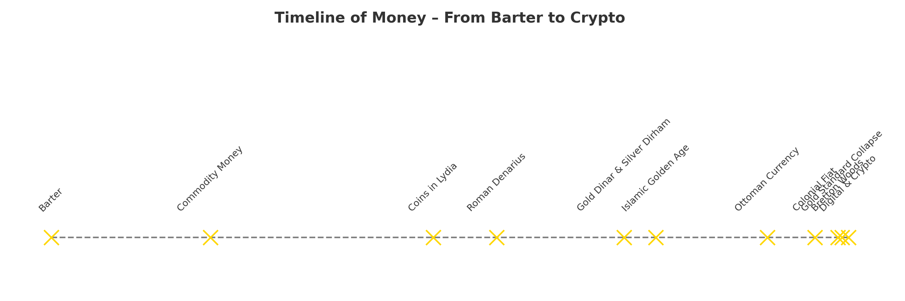

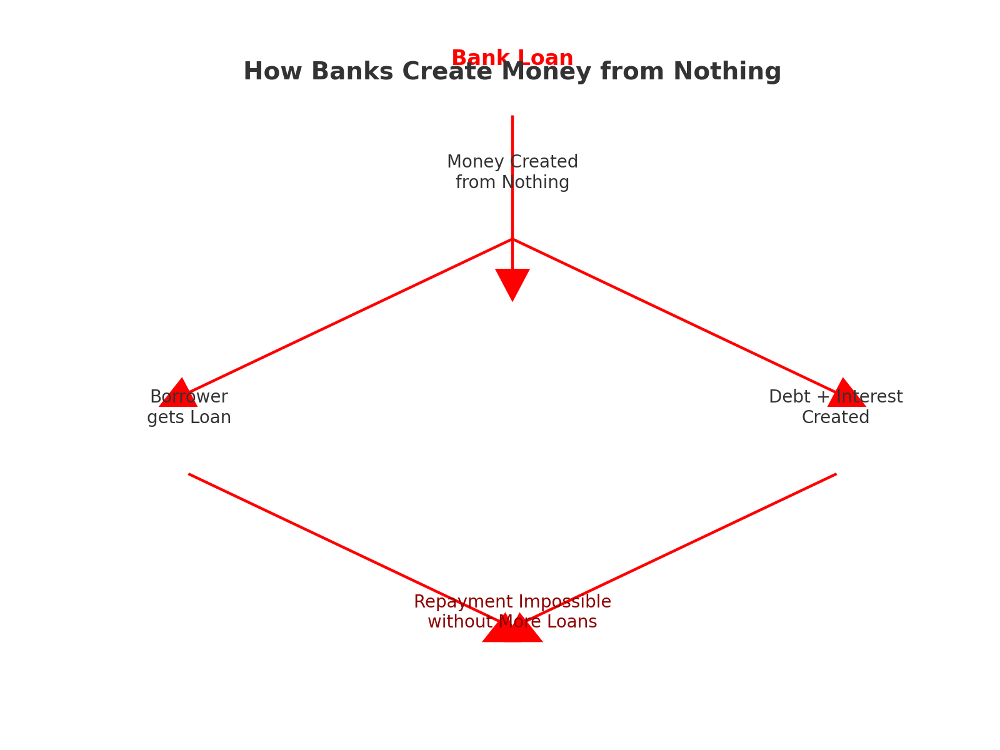

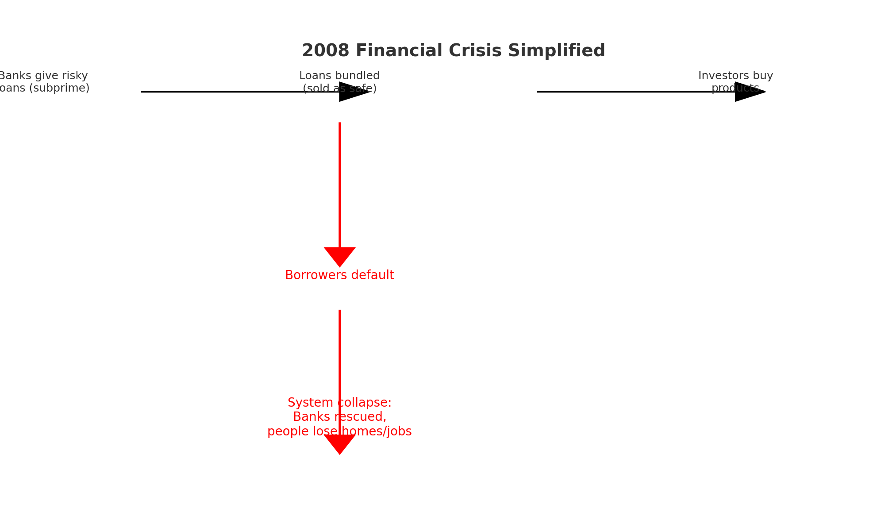

## Finance and technology

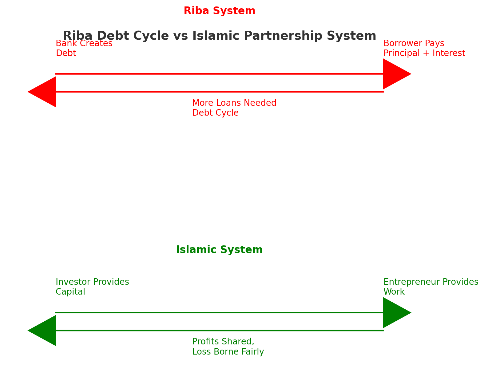

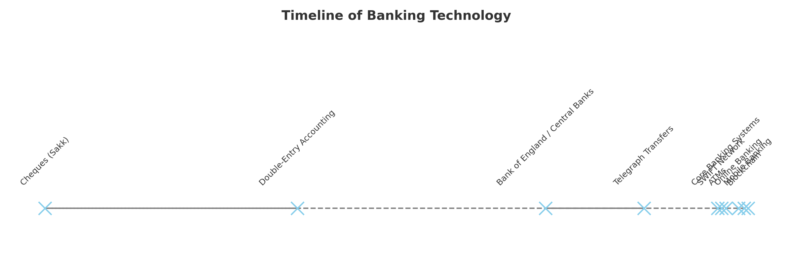

## Umicom asset-backed currency research

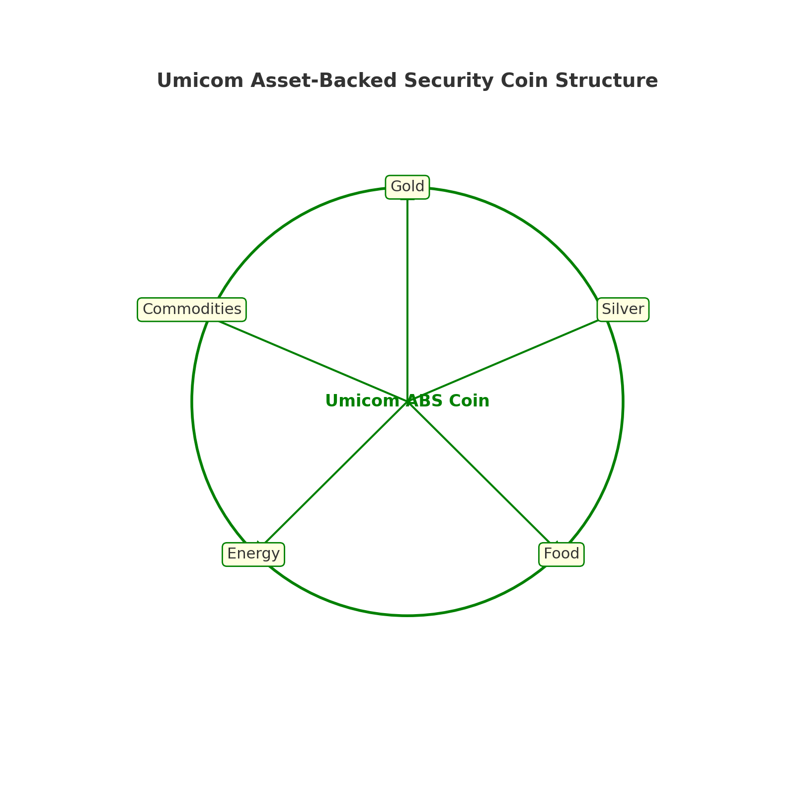

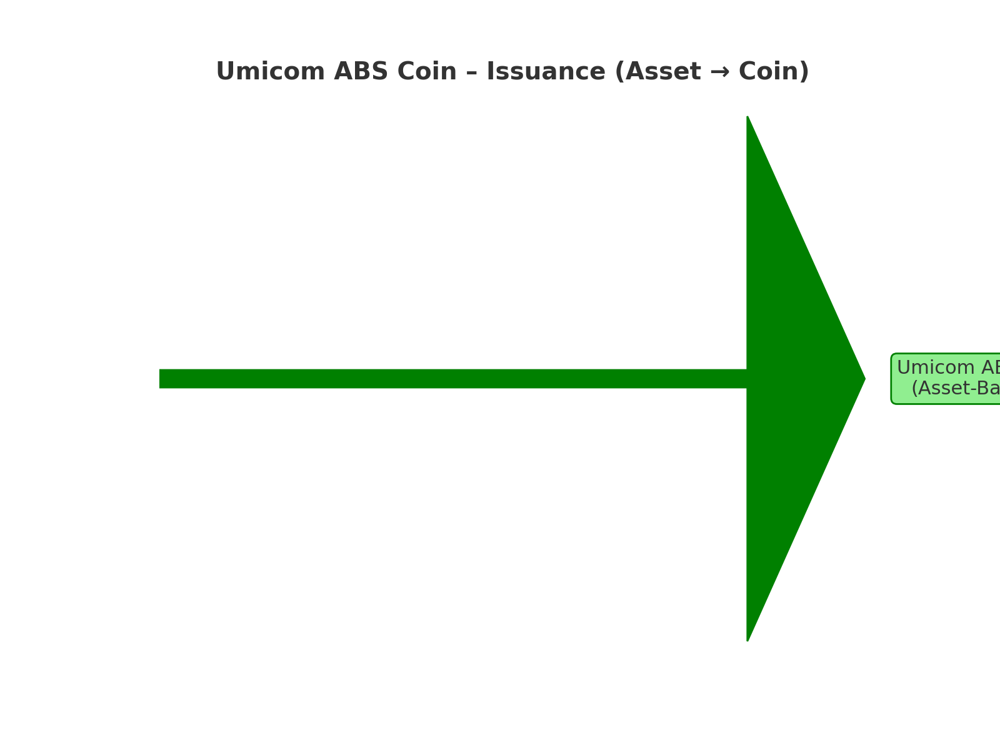

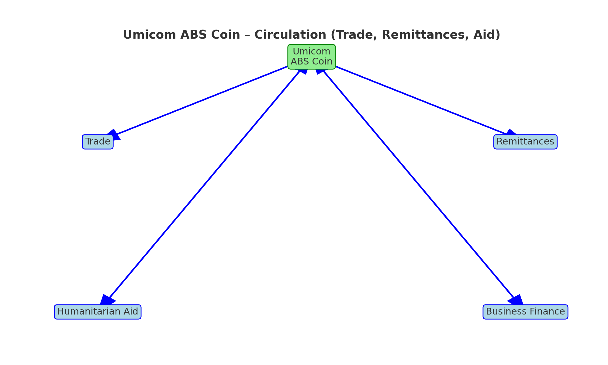

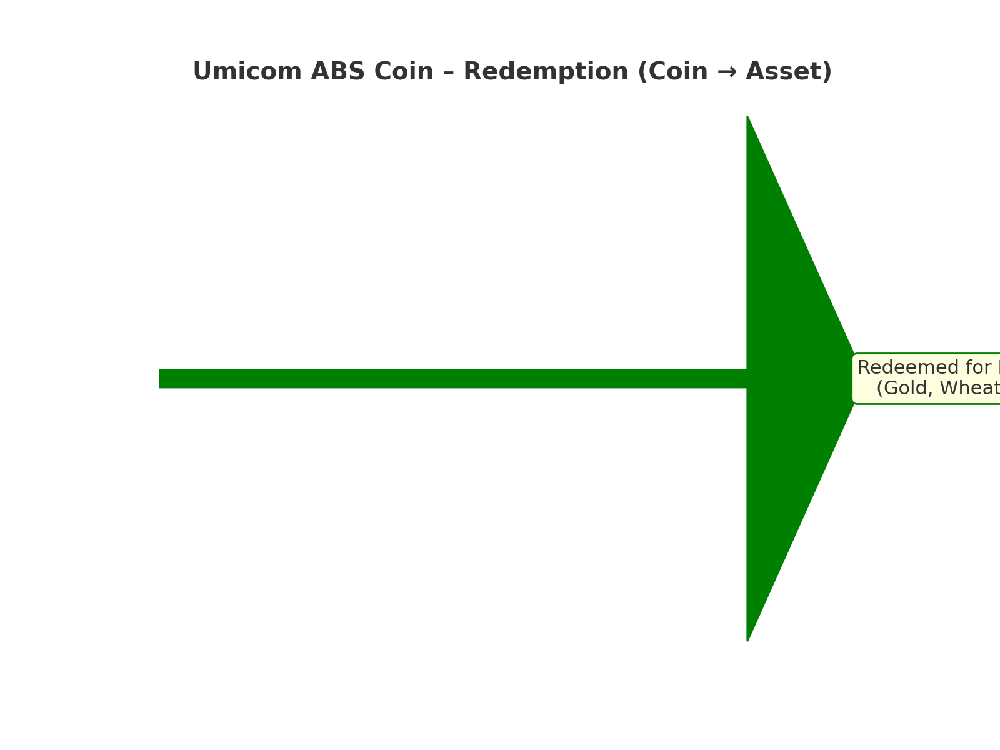

## Ethical reflections

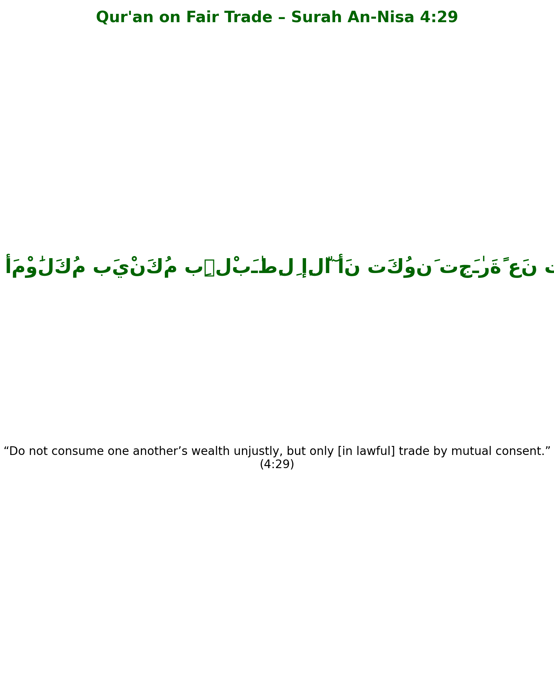

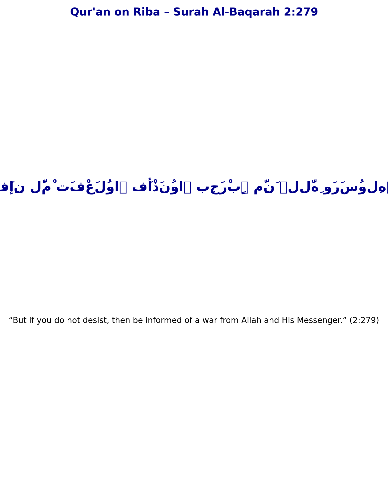

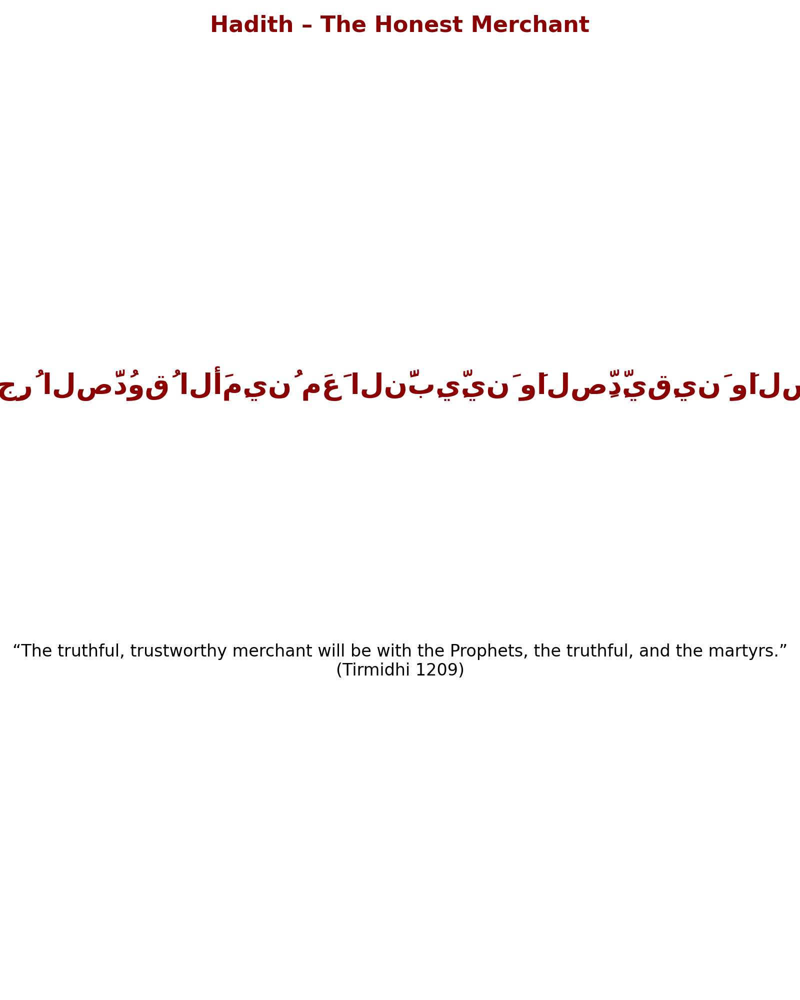

[Return to Volume 1](index.md).
